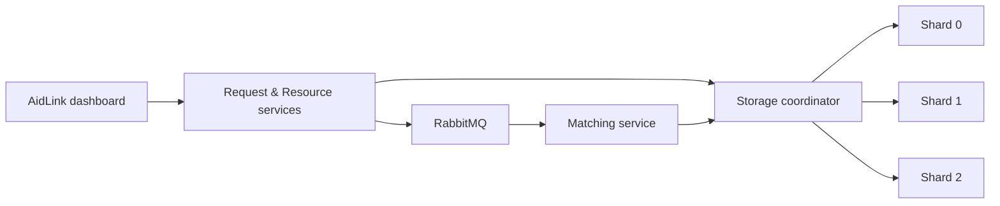

# AidLink — Emergency Resource Matching

AidLink connects emergency requests for **water, food, medicine, transport, and shelter** with available nearby resources. A React dashboard tracks requests, manages resources, and displays storage health.

Built as a local cloud-computing coursework project to demonstrate microservices, asynchronous messaging, sharding, replication, and recovery.

## What it does

- Matches requests by resource type, availability, and distance (50 km by default).
- Processes matching asynchronously through RabbitMQ.
- Distributes records across three PostgreSQL shards through a storage coordinator.
- Uses conditional database updates to prevent double allocation.
- Runs one primary and one standby per shard in Kubernetes, managed by CloudNativePG.

**Stack:** Java 21 · Spring Boot · PostgreSQL · RabbitMQ · React · TypeScript · Docker · Kubernetes

## How it fits together



There are **three business microservices and one coordinator**. Clients use public HTTP APIs; the coordinator handles database routing. See [architecture](docs/architecture.md) for transaction handling, replication, and recovery details.

## Choose a deployment

| | Docker Compose | Kubernetes with kind |
| --- | --- | --- |
| Best for | Everyday development | Replication and recovery demonstrations |
| Database instances | 3 primaries | 3 primaries + 3 standbys |
| Database failover | No standby promotion | Managed by CloudNativePG |
| Service scaling | Not part of the default demo | Manual replica scaling; automatic pod recovery |
| Website | `localhost:8088` | `localhost:8089` with port forwarding |

These deployments have separate databases. Records do not transfer automatically between them.

## Run locally

### 1. Prepare the project

Start Docker Desktop with Linux containers. The first build needs internet access; Java and Node are supplied by the Docker build stages.

```powershell
git clone https://github.com/Taneesh-Bhojawala/emergency-resource-matching.git
cd emergency-resource-matching
Copy-Item .env.example .env
```

Skip the clone if you already have the project, and do not overwrite an existing `.env`. Replace the password and token placeholders in `.env`; keep `DB_USER=emergency` for the supplied Kubernetes configuration. Use an internal token of at least 32 random characters. Never commit this file.

### 2. Start Docker Compose

```powershell
docker compose --env-file .env -f infra/compose/compose.yaml up -d --build
```

Allow the services to start, then open **[localhost:8088](http://localhost:8088)**. Check startup with:

```powershell
docker compose --env-file .env -f infra/compose/compose.yaml ps
```

To stop the deployment while keeping its data:

```powershell
docker compose --env-file .env -f infra/compose/compose.yaml down
```

Start it again with `up -d`. Add `--build` after code changes. Adding `--volumes` to `down` deletes the stored application data.

### 3. Or deploy to Kubernetes

Install **kind**, **kubectl**, and **PowerShell**, and keep Docker running. The supplied script targets the local `kind-emergency` cluster.

If Compose is running, stop it first to free machine resources:

```powershell
docker compose --env-file .env -f infra/compose/compose.yaml stop
```

Build images, create the cluster, and deploy:

```powershell
docker compose --env-file .env -f infra/compose/compose.yaml build
kind create cluster --config infra/kubernetes/kind.yaml
./scripts/deploy-kubernetes.ps1
```

Create the cluster only once; skip that command if `kind get clusters` already lists `emergency`. The script installs CloudNativePG, provisions databases and RabbitMQ, and deploys the application.

```powershell
kubectl --context kind-emergency -n emergency get clusters
kubectl --context kind-emergency -n emergency get pods
kubectl --context kind-emergency -n emergency port-forward svc/frontend 8089:8080
```

Each database cluster should have **two ready instances**. Keep the forwarding terminal open and visit **[localhost:8089](http://localhost:8089)**. Restart forwarding if its frontend pod is replaced.

## Try the application

1. In **Resources**, add an available `WATER` resource with a location and coordinates.
2. In **Requests**, create a `WATER` request using the same or nearby coordinates.
3. Wait for `MATCHED`, then select **Start response** and **Mark completed**.
4. In **Operations**, inspect shard counts and database health.

A request without suitable supply becomes `NO_RESOURCE`. Add or replenish a resource, then select **Retry matching**. Each resource represents one unit of capacity; completion makes it unavailable until explicitly replenished.

The dashboard refreshes every five seconds and summarizes the latest 200 loaded records. In Kubernetes, six database members plus three write-endpoint checks can appear as **nine health observations**, not nine databases.

## Project structure

```text
backend/    Java services, coordinator, shared contracts, migrations, tests
frontend/   React dashboard and Nginx API proxy
infra/      Docker Compose, Kubernetes, and database health reporter
scripts/    Build, deployment, integration, and recovery checks
docs/       Architecture, API reference, testing, and operations
```

## Documentation

| Guide | Contents |
| --- | --- |
| [Architecture](docs/architecture.md) | Sharding, matching flow, transactions, replication, recovery |
| [API reference](docs/api/contract.md) | Endpoints, JSON payloads, validation, and errors |
| [OpenAPI specification](docs/api/openapi.yaml) | Machine-readable API contract |
| [Development and testing](docs/development.md) | Build commands, test scripts, CI, troubleshooting |
| [Operations runbook](docs/runbook.md) | Updates, scaling, failure drills, and backups |
| [Security and limits](docs/security-and-limits.md) | Access controls and availability limitations |

## Scope and limitations

This is an academic demonstration using synthetic data, not a production emergency service. Public APIs have no user authentication. Replication is asynchronous and can lose recent writes during primary failure. The coordinator and RabbitMQ are single instances, and a local kind cluster cannot survive failure of its host computer.

Automated checks are included, but their presence does not establish a passing result. See the repository's Actions runs and locally generated evidence for actual verification results.
